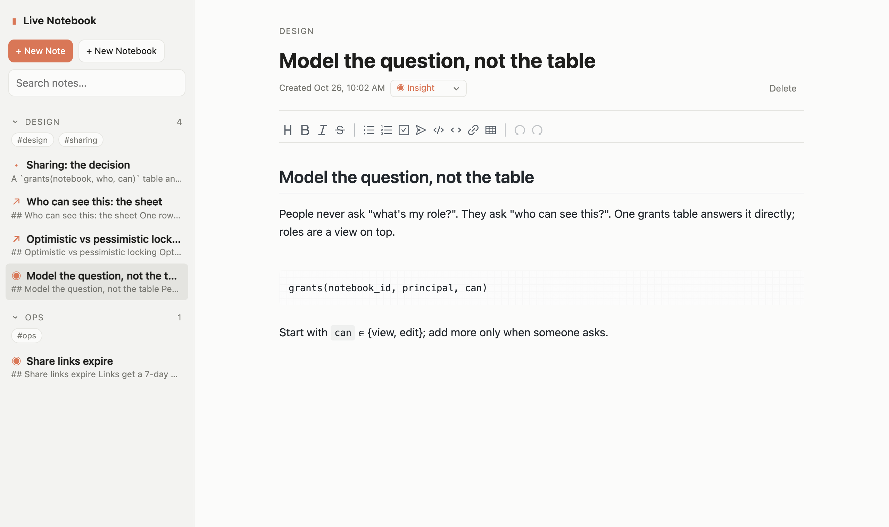

# Live Notebook

**Markdown notes from your Claude Code conversations, kept on your own computer.** Save the useful parts of a reply (the whole thing or a few lines), find them again in seconds, and tidy them up in a notebook that opens in your browser. Free, open source, local-first: no account, no cloud.

[](https://amberwjl.github.io/live-claude-notebook/)

**[▶ Watch the 49-second film](https://amberwjl.github.io/live-claude-notebook/)** ([MP4](docs/media/live-notebook.mp4), with sound)



Works in the Claude Code terminal and desktop app. Every note is a plain `.md` file you can open in any editor. Website and guides: [amberwjl.github.io/live-claude-notebook](https://amberwjl.github.io/live-claude-notebook/).

## Install in Claude Code

In a Claude Code session, run:

```
/plugin install live-notebook --marketplace AmberWJL/live-claude-notebook
```

Answer `y` to add the marketplace and pick a scope. Live Notebook is on
right away and in every later session. To update later:

```bash
claude plugin update live-notebook
```

You need Claude Code 2.1.293 or newer and Node.js 18 or newer. The web
notebook works offline: its editor ships with it.

## Quick start

1. Ask Claude something. Under any reply you will see a dim **Save to notebook** control. Press it.
2. The notebook pane opens with the text ready to save. Click the title at
   the top to change it, or leave it as is. Pick a notebook, press **Save**.
3. Type `/notebook` any time to browse and search everything you have saved.

That is the whole loop. Nothing is saved until you press Save, and nothing
you save is ever fed back into Claude's context.

## Ways to save

| Do this | What happens |
| --- | --- |
| Press **Save to notebook** under a reply | That reply opens in the pane, ready to save |
| Highlight part of a reply, then type `/save` | Only the highlighted text is captured |
| `/save some text you type` | The typed text is captured |

Before saving you can edit the text, click the title at the top to rename
it, choose a notebook (or type a new name to create one) and set a type. A small toolbar gives
you headings, bold, italic, code, links, lists and quotes. Saving the same
message twice reopens the existing note instead of making a copy.

## The notebook pane

Open it with `/notebook`, or `/notebook <words>` to open it already
searching.

- **Search** filters as you type. The filters under it narrow to Insights,
  Learnings, References or Other.
- **Notebooks** are collapsible groups. Each note is one line with its type
  mark and title.
- **Click a note** to read it. **Edit** opens it in the pane editor;
  **Open in web** opens it in your browser.
- **Write Note in Web** starts an empty note in your browser. **+ New Notebook**
  asks for a name.
- **Export** on a notebook saves it as one markdown file (choose a `.txt`
  name for plain text).
- The `⋯` menu on a note archives it or deletes it. To change its type,
  press **Edit** and use the Type picker.

After every save a short "Saved to …" line appears with an Open button.

Types, titles and tags are filled in for you a few seconds after a save. A
title or type you set yourself is kept.

## The web notebook

Run `/notebook web`, or press **Open in web** on any note. The page shows your notebooks and notes in a sidebar and
the open note in an editor that renders markdown as you type. Changes save
on their own and show up in the pane within a few seconds.

On the web you can also:

- **Right-click a note** to pin it to the top, archive it or delete it. ⌘-click
  (ctrl-click) or shift-click picks several notes; the menu then acts on all of
  them (Pin 4, Archive 4, Delete 4).
- **Right-click a notebook** to pin it to the top of the list, archive it with
  its notes, or delete it (the folder moves to the trash folder).
- **Drag a note** onto another notebook to move it.
- **Export** a notebook as a markdown or text file.

## Where your notes live

Every note is a plain markdown file under
`~/.claude/live-notebook/notes/<Notebook>/`. Open them in any editor; Live
Notebook picks up your changes. Each file's front matter holds the note's
title, notebook, type, tags, dates, and, for a note saved from a
conversation, who wrote it (`role`), the session, and the project folder's
name. The text exactly as it was first saved, before any edit, is kept
beside it in `~/.claude/live-notebook/sources/<id>.json`. Deleted notes go
to `~/.claude/live-notebook/trash/`. Back up that one folder and you have
everything.

To keep the notes somewhere else, set `LIVE_NOTEBOOK_HOME` to a folder
before starting Claude Code.

## Privacy

Your notes stay on your machine. Live Notebook has no account, no server of
its own and no analytics. The web notebook runs on your computer, answers
only its own page, and loads nothing from the internet.

One thing can leave your machine: to pick a note's type, a title and tags,
Live Notebook asks a small Claude model through your own Claude Code
account. It sends a note's title and first 1,200 characters, and for a
notebook's tags, the titles and first 300 characters of up to 20 notes and
the names of the project folders they were saved in. By default it only
does this for notes saved from a Claude Code conversation, whose text
Claude has already seen. Notes you write yourself on the web or in an
editor are not sent.

To change that, create `~/.claude/live-notebook/settings.json`:

```json
{ "ai": "off" }
```

`"off"` sends nothing, `"chat-only"` is the default, and `"all"` also sends
notes you wrote yourself.

Live Notebook does not keep the messages around a saved reply, nor your
project's full path. Notes saved by earlier versions still hold them in
Claude Code's plugin store, but no file contains them.

## Troubleshooting

- **The web notebook will not open.** Run `npm run web:stop` in the plugin
  folder, then open it again from the pane.
- **I see an old version.** Run `claude plugin update live-notebook` and
  start a new session.

## For developers

Build, test and data details are in [docs/DEVELOPMENT.md](docs/DEVELOPMENT.md).
Getting it found (the site, Search Console, listings): [docs/PUBLISHING.md](docs/PUBLISHING.md).

Live Notebook is MIT licensed and not affiliated with Anthropic.
