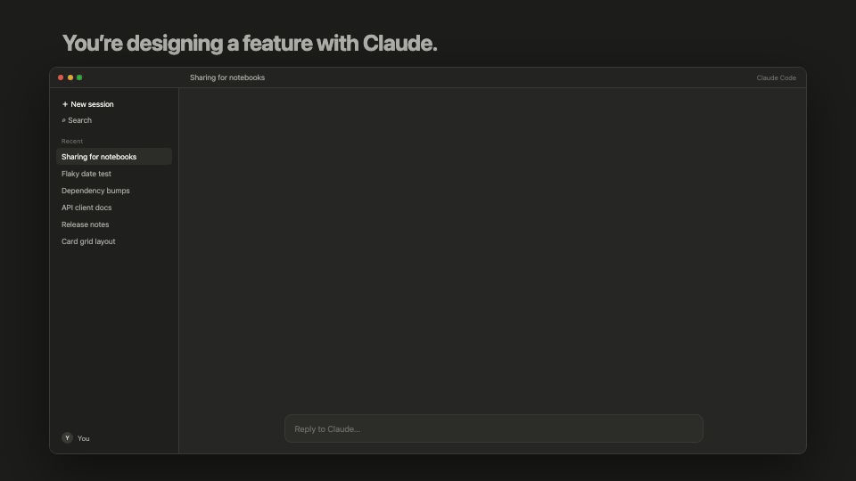
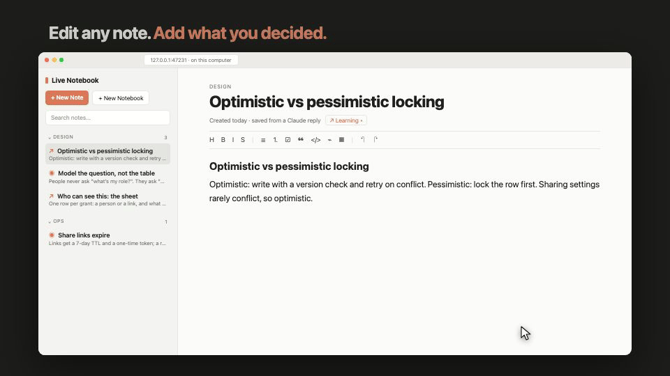
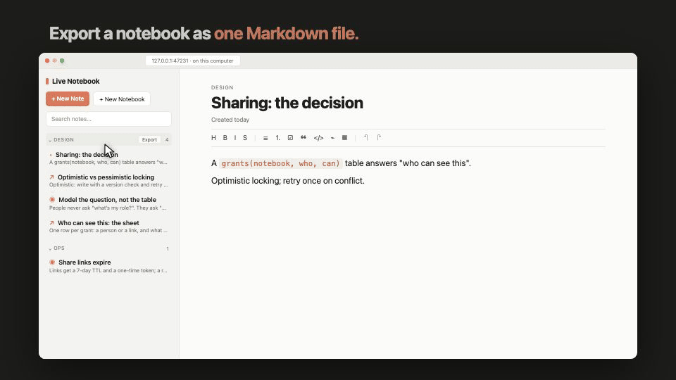

# Live Notebook

**Markdown notes from your Claude Code conversations, kept on your own computer.** A Save to notebook button under every reply; search, edit and export in a notebook that opens in your browser. Free, open source, local-first: no account, no cloud.

**[▶ Watch the demo video](https://amberwjl.github.io/live-claude-notebook/)**

## What it does



**You're designing a feature with Claude. It says something worth keeping: one click saves it, right beside the chat. A side question's answer gets buried by the rush; scroll back, and there's a button under every reply.** Every note is a plain Markdown file on your computer, and search finds it again in a second.



**Edit any note, add what you decided, or write your own.**



**Export a notebook as one Markdown file: a design doc, ready to share.**

## Install

In a Claude Code session (terminal or desktop app), run:

```
/plugin install live-notebook --marketplace AmberWJL/live-claude-notebook
```

Answer `y` to add the marketplace and pick a scope. To update later: `claude plugin update live-notebook`. Needs Claude Code 2.1.293 or newer and Node.js 18 or newer.

## How it works

- **Save to notebook** under any reply opens the pane with that reply ready. Edit it, rename it, pick a notebook and a type, press **Save**. Nothing is saved until you do, and nothing you save goes back into Claude's context.
- Highlight part of a reply and type `/save` to keep just that; `/save some text` keeps what you type.
- `/notebook` browses and searches everything; `/notebook <words>` opens it already searching. Click a note to read it, **Edit** to change it, **Open in web** for the browser.
- `/notebook web` opens the web notebook: your notebooks in a sidebar, the open note in an editor that renders Markdown as you type. Right-click to pin, archive or delete; drag a note onto another notebook to move it; **Export** a notebook as one Markdown or text file.
- Types, titles and tags are filled in for you a few seconds after a save; anything you set yourself is kept.

## Where your notes live

Every note is a plain Markdown file under `~/.claude/live-notebook/notes/<Notebook>/`, with its title, notebook, type, tags and dates in the front matter. Open them in any editor; Live Notebook picks up your changes. Deleted notes go to `trash/`. Back up that one folder and you have everything. Set `LIVE_NOTEBOOK_HOME` to keep it somewhere else.

## Privacy

Your notes stay on your machine: no account, no server of its own, no analytics. The web notebook runs on your computer and loads nothing from the internet.

One thing can leave: to pick a note's type, title and tags, Live Notebook asks a small Claude model through your own Claude Code account, sending the note's title and first 1,200 characters (for a notebook's tags, a little of each note). By default this happens only for notes saved from a conversation, whose text Claude has already seen. To change it, create `~/.claude/live-notebook/settings.json` with `{ "ai": "off" }` (or `"all"` to include notes you wrote yourself).

## Troubleshooting

- **The web notebook will not open:** run `npm run web:stop` in the plugin folder, then open it again.
- **I see an old version:** run `claude plugin update live-notebook` and start a new session.

## For developers

[docs/DEVELOPMENT.md](docs/DEVELOPMENT.md) has build, test and data details.

MIT licensed. Not affiliated with Anthropic.
